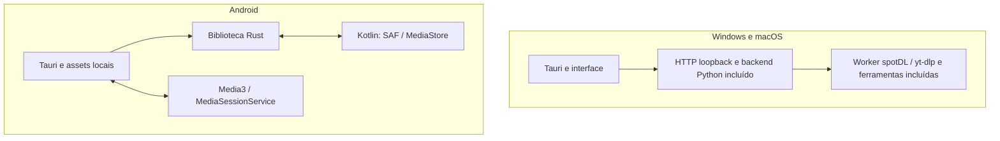

# Plano de evolução do Acervo

[English](ROADMAP.md) · **Português**

As 15 funcionalidades abaixo fazem parte do escopo planejado do projeto.
As caixas indicam a entrega completa e validada de cada item; recursos que já
tenham suporte parcial devem ser aproveitados e ampliados.

**Prioridade atual (12/11/2026):** planejar o empacotamento para Windows,
macOS e Android, conforme [Empacotamento multiplataforma](#empacotamento-multiplataforma).
O plano orienta a implementação; os instaladores ainda não foram entregues.
Os 15 itens funcionais abaixo continuam como referência, sem acrescentar
recursos ao trabalho de empacotamento. Downloads com spotDL e organização da
biblioteca existente devem continuar disponíveis no desktop.

## Regras para todas as etapas

- Manter a biblioteca nos caminhos atuais, sem criar pastas por gênero ou álbum.
- Armazenar informações musicais nos metadados dos arquivos, com compatibilidade
  com players. Filtros, preferências e tarefas podem usar o banco local do app.
- Apresentar uma prévia e exigir aprovação antes de modificar a coleção.
- Fazer backup verificável e permitir restauração das alterações.
- Preservar capas, tags válidas, faixas distintas e versões legítimas.
- Não excluir, renomear ou reconverter arquivos automaticamente. Downloads e
  substituições devem ser escolhidos explicitamente.
- Encaminhar identificações ambíguas para revisão e registrar suas fontes.
- Manter caminhos configuráveis e permitir o uso sem Spotify Premium.

## Funcionalidades

- [ ] **1. Álbuns incompletos**
  Comparar a coleção com a lista de faixas da edição escolhida, mostrando
  presentes, ausentes e correspondências duvidosas. Permitir selecionar e baixar
  somente as faixas faltantes, sem substituir as existentes por padrão.

- [ ] **2. Comparador de edições**
  Comparar original, remaster, deluxe e versões ao vivo por discos, faixas,
  duração e identificadores disponíveis. Mostrar faixas extras e diferenças
  antes da unificação, preservando a identificação da edição e da gravação.
  Compartilhar um Release Group não basta para tratar gravações como iguais.

- [ ] **3. Identificação pelo áudio**
  Usar impressão digital acústica como evidência adicional para músicas com
  nomes ou tags incorretos. Exibir candidatos, fonte e confiança; resultados
  ambíguos exigem revisão. Informar quando uma consulta enviar a impressão
  digital a um serviço externo.

- [ ] **4. Possíveis duplicatas**
  Distinguir arquivos idênticos por hash, possíveis codificações diferentes da
  mesma gravação e versões alternativas. Oferecer comparação e reprodução,
  sem apagar automaticamente nem concluir duplicidade somente por título ou álbum.

- [ ] **5. Origem de cada informação**
  Registrar por campo o valor atual, a sugestão, a fonte, a data da consulta e
  as evidências da identificação. Diferenciar regras locais, escolhas manuais
  e dados externos; explicar a confiança sem inventar precisão numérica.

- [x] **6. Campos protegidos**
  Permitir proteger campos de uma faixa ou de um conjunto de faixas, como
  gênero e edição do álbum. Persistir a escolha e respeitá-la em análises,
  enriquecimentos e substituições, até o usuário desbloquear o campo.
  Disponível na CLI, nos detalhes da faixa e em lote para as faixas atuais de
  um álbum. A política local é separada por biblioteca e revalidada ao gravar
  ou restaurar, inclusive para planos antigos. Campos vazios também podem ser
  protegidos. Não há reassociação automática quando um arquivo muda de caminho.
  Testes Python/HTTP e Chromium em desktop/celular validam persistência,
  desbloqueio e leitura da biblioteca mesmo com a política ilegível.

- [ ] **7. Gêneros personalizados**
  Oferecer edição de regras por artista, álbum e faixa, com múltiplos gêneros.
  Documentar a prioridade entre regras, respeitar campos protegidos e validar
  a leitura de TCON e GENRE nos players considerados compatíveis.

- [ ] **8. Coleções inteligentes**
  Salvar filtros combinados por gênero, período, artista, formato e pendências,
  incluindo álbuns incompletos e músicas sem capa. Atualizar os resultados
  conforme a biblioteca muda, sem mover arquivos.

- [ ] **9. Fila de downloads persistente**
  Salvar tarefas e seus estados para recuperar a fila após fechar o programa.
  Permitir pausar, cancelar e tentar novamente, com erros claros. Quando a
  ferramenta não permitir retomar bytes, indicar que a tentativa será reiniciada.
  Manter os downloads fora da coleção até a aprovação da importação.

- [ ] **10. Comparação antes da substituição**
  Permitir ouvir o arquivo atual e o candidato, comparando duração, formato,
  bitrate, frequência de amostragem, canais, tags e capa. Não apresentar bitrate
  maior como prova de qualidade superior. Exigir escolha explícita e backup
  para substituir um arquivo, preservando os originais até a aprovação.

- [ ] **11. Histórico visual**
  Mostrar alterações por execução, faixa e campo, com valores anteriores e
  posteriores. Permitir desfazer uma faixa ou um lote após conferir integridade
  e possíveis edições posteriores; registrar também importações e substituições.

- [ ] **12. Modo de descoberta**
  Explorar artistas pouco ouvidos, álbuns esquecidos e gêneros de interesse.
  Explicar o motivo de cada sugestão. Usar histórico de reprodução somente
  quando disponível e habilitado, sem confundir falta de dados com pouca escuta.

- [x] **13. Playlists portáteis**
  Exportar seleções e coleções em M3U8 com caminhos relativos à playlist,
  codificação UTF-8 e nomes com acentos. Validar a resolução dos caminhos
  depois de transportar a playlist junto com a coleção correspondente.
  Disponível pela CLI e pelo botão **Exportar M3U8** da Biblioteca/Álbuns.
  A interface mostra prévia, salva em `Playlists/` e exige confirmação para
  substituir uma playlist, guardando antes uma cópia verificável fora da coleção.
  Validado com acentos, múltiplas páginas, álbuns homônimos, cópia para outro
  disco e navegação em desktop/celular. A restauração da playlist anterior é
  manual, pelo caminho do backup exibido após a substituição.

- [ ] **14. Sistema de extensões**
  Definir interfaces documentadas para fontes de metadados, ferramentas de
  download e regras. Permitir extensões opcionais sem modificar o núcleo,
  mantendo aprovação, campos protegidos, validação e backup no núcleo.
  Informar que extensões executam código e devem vir de fontes confiáveis.

- [ ] **15. Modo demonstração**
  Disponibilizar uma biblioteca fictícia com áudio próprio ou de licença
  compatível, créditos e casos de metadados incompletos, edições e duplicatas.
  Permitir testar a interface e contribuir sem acessar a coleção pessoal,
  com dados e backups de demonstração isolados e opção de reiniciar a demonstração.

## Ordem proposta de entrega

| Etapa | Itens | Resultado esperado |
| --- | --- | --- |
| 1 — Decisões e rastreabilidade | 5, 6, 7 e 11 | Entender as sugestões, preservar escolhas e revisar ou desfazer alterações. |
| 2 — Identificação e álbuns | 3, 4, 2 e 1 | Comparar gravações e edições para reconhecer o que existe e o que falta. |
| 3 — Downloads e portabilidade | 9, 10 e 13 | Recuperar tarefas, revisar substituições e exportar playlists. |
| 4 — Exploração e contribuições | 8, 12, 14 e 15 | Explorar a coleção e facilitar extensões e demonstrações públicas. |

A ordem orienta prioridades, sem estabelecer datas. Funcionalidades
independentes podem ser antecipadas. A comparação de edições deve preceder a
classificação definitiva de faixas faltantes; a revisão e o backup devem estar
disponíveis antes de qualquer substituição.

## Critério de conclusão

Marcar um item somente depois de verificar seu comportamento, documentar o uso
e as limitações e validar os casos relevantes em uma biblioteca de teste.
Fluxos que gravem arquivos devem demonstrar preservação dos dados não aprovados
para alteração e restauração dos originais. O modo demonstração não deve incluir
arquivos, credenciais ou relatórios pessoais.

## Empacotamento multiplataforma

**Plano de engenharia: 12/11/2026. Estado: planejado.** Base inspecionada:
commit `b81425a`. Alterações paralelas de downloads não fazem parte deste lote.
As versões mínimas são propostas a validar; requisitos de lojas precisam ser
conferidos novamente em cada release. Nenhuma caixa de entrega é concluída
apenas pela existência deste documento.

### 1. Resultado e decisões de arquitetura

Instalar, escolher a biblioteca e usar sem Python, Rust, pipx, SDKs ou terminal
no computador do usuário. Biblioteca e reprodução local funcionam offline;
consultas, downloads e atualização são recursos de rede identificáveis.

| Plataforma | Suporte inicial proposto | Artefato | Canal inicial |
| --- | --- | --- | --- |
| Windows | Windows 11, x86_64 | NSIS `.exe`, instalação por usuário | GitHub Releases, assinado |
| macOS | macOS 14+, Apple Silicon e Intel | Dois `.dmg`, cada um com `Acervo.app` | GitHub Releases, assinado e notarizado |
| Android | Android 10 / API 29+, arm64-v8a | APK assinado; depois AAB | Beta direto; Google Play em etapa própria |

Não anunciar Windows ARM64 por emulação, Windows 10, Android 32 bits ou outros
alvos sem validá-los. MSI, universal2 do macOS, Microsoft Store, Mac App Store
e F-Droid são expansões posteriores. Android será independente do computador.

Manter Tauri 2 e a interface existente. **Desktop primeiro com backend Python
incluído**; não esperar terminar todo o port Rust para entregar instaladores.
**Android com núcleo Rust e integração Kotlin**, sem servidor Python de PC.
PyInstaller inclui o interpretador/dependências, mas seu resultado depende do
SO e arquitetura; produzir cada backend no sistema correspondente.
[Funcionamento do PyInstaller](https://pyinstaller.org/en/stable/operating-mode.html).



### 2. Bloqueios reais encontrados

| Local atual | Limitação | Trabalho planejado |
| --- | --- | --- |
| `desktop/tauri.conf.json` | `bundle.active=false` | Configurar instaladores, ícones e recursos por alvo |
| `desktop/src/main.rs` | `python3`, `.venv/bin/python`, `libc::kill`, `xdg-open` | Backend incluído, abertura nativa de links e encerramento por protocolo |
| Launcher desktop | Reserva/libera porta; prontidão só por conexão TCP | Bind pelo backend e handshake da própria instância |
| Python core/MusicBrainz | `fcntl`, `O_DIRECTORY`, fsync de diretório | Adaptadores de locks e persistência Windows/Unix |
| Importação, playlists e restore | Dependem de hard links/substituição local | Detectar capacidades e implementar publicação equivalente sem sobrescrita |
| Downloader | Descobre o Python do spotDL pelo shebang | Entrada explícita do worker; `.exe` não é script com shebang |
| `paths.py`, `folders.py`, cache de letras | Convenções XDG | Dados, cache e seletor nativos por SO |
| Rust `scan.rs`, `plan.rs` | `std::os::unix::fs::MetadataExt` | Identidade/assinatura/persistência por plataforma |
| `acervo-core` | Leitura, inventário e plano; não é todo o backend | Portar escrita, restore, estado, busca e serviços necessários ao Android |
| Interface/player | HTTP e `HTMLAudioElement` | Assets locais e transporte nativo no Android |
| CI | Ubuntu | Jobs Windows/macOS/Android e testes dos pacotes instalados |

O primeiro marco deve reproduzir e resolver esses bloqueios em ambientes
limpos. Compilar a janela ou abrir Chromium em resolução móvel não demonstra
que um instalador ou um app Android estão prontos.

### 3. Contratos compartilhados e organização

Separar `LibraryStorage`, `AudioTransport`, `DownloadProvider` e cliente da
interface. Caminho desktop e URI `content://` são localizadores diferentes:
não converter URI em `Path`, nem transportar o modelo Unix para o Android.
Manter regras, dados musicais e testes comuns. Acrescentar protocolo versionado
e capacidades para detectar incompatibilidade antes de permitir escritas.

Criar entrada Tauri compartilhada em `desktop/src/lib.rs`; deixar `main.rs`
como entrada desktop e subprocessos sob `cfg(desktop)`. Integrar armazenamento
e player Android por plugins Kotlin, preservando customizações ao regenerar o
projeto Android. [Plugins móveis Tauri](https://v2.tauri.app/develop/plugins/develop-mobile/).

Preservar chaves/formato dos manifestos antigos e contrato HTTP. A versão do
app, a do protocolo e a do armazenamento são distintas. Cada substituição de
uma operação Python por Rust exige equivalência e testes de preservação;
portar leitura não valida automaticamente gravação e restauração.

Estrutura proposta, ainda não criada:

```text
packaging/                 # backend.spec, entradas, locks e licenças
scripts/release/           # build, montagem e verificação dos pacotes
desktop/tauri.*.conf.json  # Windows, macOS e Android
desktop/src/platform/     # ciclo de vida e integração nativa
desktop/plugins/          # acervo-storage e acervo-media
src/acervo/platform/      # paths, locks, processos e publicação desktop
crates/acervo-core/       # storage, writer e transações portáveis
tests/packaging/          # fixtures e testes de instaladores
.github/workflows/        # testes desktop/Android e release separado
```

Definir o layout final em P0. Não trocar o frontend ou introduzir um framework
para empacotar. Se plugins/bindings exigirem etapa de assets, mantê-la mínima.

### 4. Runtime desktop completo

O pacote padrão mantém biblioteca, player, tags, capas, letras, Histórico e
downloads. Usar inicialmente **PyInstaller onedir**, com recursos explícitos;
considerar onefile apenas depois de medir abertura, tamanho e diagnóstico.

- Incluir Python, Mutagen, assets, traduções, regras CSV, CAs necessárias,
  imports dinâmicos e dados dos providers; não apenas o executável onedir.
- Criar entradas congeláveis de servidor e worker, com comandos de busca,
  catálogo e download. `sys.executable -I script.py` não funciona como um
  interpretador genérico quando `sys.executable` é o programa congelado.
- Incluir spotDL, yt-dlp, ffmpeg/ffprobe e suas dependências fixadas. Na prova
  inicial, verificar se o provider escolhido exige runtime JavaScript;
  incluí-lo com versão, hash e licença se necessário.
- Fixar runtime Python, PyInstaller, Rust, Tauri e árvore completa de release
  em locks/hashes. Não mudar o suporte da CLI só para fixar o Python distribuído.
- Resolver ferramentas por caminho absoluto no bundle, evitando colisão com
  diretório atual/PATH. Incluir tudo por arquitetura, com inventário verificável.
- Não executar pip, atualização independente do provider, download de ffmpeg
  ou scripts remotos na instalação/primeira abertura. Atualizar o conjunto
  pelo release testado do Acervo.

Os sidecars Tauri usam sufixo de target triple: planejar
`x86_64-pc-windows-msvc`, `aarch64-apple-darwin` e `x86_64-apple-darwin`.
Todos os componentes nativos de cada pacote devem corresponder ao alvo.
[Sidecars Tauri](https://v2.tauri.app/develop/sidecar/).
Validar as pastas de bibliotecas/dados dentro do pacote real; recursos
congelados são somente leitura.
[Recursos do PyInstaller](https://pyinstaller.org/en/stable/runtime-information.html).

### 5. Escrita segura e sistemas de arquivos

Adaptar locks, identidade, fsync, publicação exclusiva, substituição e processos
em core, importação, MusicBrainz, playlists, downloads e Histórico. Não resolver
Windows removendo locks ou ignorando erros de sincronização. Testar a mesma
exclusão mútua entre GUI, CLI e duas instalações que abram a mesma biblioteca.

No Windows, tratar nomes reservados, caminhos longos, unidades, junctions e
reparse points. No macOS, APFS sensível/insensível a maiúsculas e Unicode
NFC/NFD. Identidade de arquivo não depende exclusivamente de inode Unix nem
somente de hash: arquivos idênticos podem ser faixas deliberadamente distintas.

Toda escrita exige: prévia vigente; destino/permissões válidos; backup completo
conferido; versão pronta validada; original revalidado; publicação; manifesto;
restore. Usar temporário no mesmo volume quando necessário. Erros de espaço,
disco desconectado, arquivo ocupado ou modificação concorrente preservam os
originais/backup e produzem recuperação compreensível.

| Armazenamento | Política inicial |
| --- | --- |
| NTFS/APFS locais | Escrita completa só após testes nativos de transação e restore |
| exFAT/FAT32 e volumes sem hard links | Leitura; cada escrita depende de alternativa equivalente comprovada |
| SMB, sincronização e nuvem | Escrita suportada apenas em modos explicitamente validados |
| MTP no desktop | Não tratar como disco local; exportação/importação ou adaptador futuro |
| URI Android sem publicação segura | Leitura e exportação de cópia editada, preservando o original |

Nunca truncar o original como fallback silencioso de substituição atômica.
Capacidades são por operação e provider, não uma única flag de "gravável".
No Windows, coordenar handles da reprodução com a edição; quando necessário,
pausar/liberar e retomar a posição. Antivírus ou outro player segurando o
arquivo devem provocar erro recuperável, não encerramento forçado.

### 6. Inicialização, encerramento e dados

1. Tauri resolve recursos/dados e inicia o backend incluído sem console visível.
2. O backend faz bind em `127.0.0.1:0` e comunica a porta real por canal privado,
   com protocolo, build e desafio de inicialização. Não reservar/liberar porta
   antes do bind; não aceitar prontidão de um processo estranho só por TCP.
3. Falha de inicialização oferece diagnóstico e nova tentativa. Tokens não
   ficam em argumentos, URLs públicas ou logs. Preservar Host/Origin, CSP e
   autenticação das escritas; não abrir `0.0.0.0` para facilitar a integração.
4. Links externos usam mecanismo nativo. Não conceder shell/arquivos/IPC
   privilegiado a páginas remotas ou liberar origens localhost por wildcard.
5. Segunda abertura foca a instância existente. O lock da coleção continua
   protegendo contra gravação por CLI ou outra versão.
6. Encerrar solicita parada autenticada, bloqueia novas tarefas e aguarda o
   ponto seguro das escritas. Gerenciar árvore de subprocessos no Windows e
   grupos no Unix; queda abrupta deixa diário/backups para recuperação.

| Tipo | Windows | macOS | Android |
| --- | --- | --- | --- |
| Estado e Histórico | `%LOCALAPPDATA%\Acervo\` | `~/Library/Application Support/Acervo/` | Dados privados persistentes |
| Cache descartável | Subpasta `Cache` | `~/Library/Caches/Acervo/` | Cache privado |
| Logs | Subpasta `Logs` | `~/Library/Logs/Acervo/` | Logs privados/exportação escolhida |
| Músicas | Pasta escolhida | Pasta escolhida | URI/pasta autorizada |

Passar diretório de dados explicitamente ao backend. Não escrever em Program
Files, `.app`, DMG, APK ou extração temporária. Backups não são cache. Separar
stable/beta; manter opção avançada de diretório configurável.

Primeira abertura usa seletor nativo, aceita cancelar/pasta vazia, trata volume
ausente e permissão revogada sem apagar Histórico. Música é sugestão de pasta,
não obrigação. Não exigir acesso irrestrito ao disco por padrão.

Migração de instalação antiga: prévia, espaço, cópia, hashes, origem preservada
e registro. Não mover músicas ou reescrever manifestos silenciosamente. Backups
v1 e chaves em português continuam legíveis/restauráveis. Caminhos de outra
máquina/SO exigem reassociação explícita e verificação do arquivo correto.

### 7. Windows

- NSIS x64 por usuário, desinstalador, atalhos e instalador PT-BR/EN. Uso normal
  sem administrador. Instalação para todos os usuários e MSI são fases próprias.
- Incluir `.ico`, metadados de produto/versão, suporte a caminhos longos e
  runtime necessário; testar com Python e ferramentas ausentes do PATH.
- WebView2 Evergreen com instalador **offline incluído**. Um instalador online
  menor pode vir depois, identificado. Não usar `skip` presumindo runtime.
  [Instaladores e WebView2](https://v2.tauri.app/distribute/windows-installer/).
- Authenticode e timestamp para executáveis próprios e instalador. Selecionar
  fornecedor/identidade elegível e custódia da chave. Assinatura não dá reputação
  imediata garantida no SmartScreen; testar o arquivo baixado e Smart App Control
  sem orientar a desligar proteções.
  [Assinatura Windows](https://v2.tauri.app/distribute/sign/windows/).
- Testar usuário comum, NTFS, arquivos em uso/somente leitura, nomes com acentos,
  instalação/reinstalação e atualização. Um MSI futuro precisa de identidade
  de upgrade e estratégia para não conflitar com NSIS.
- Desinstalar remove o programa; preserva músicas e, por padrão, dados de
  recuperação. Apagar esses dados exige escolha explícita separada.

### 8. macOS

- DMGs arm64 e x86_64 separados. Universal2 só quando Python, extensões e todas
  as ferramentas também contiverem os dois alvos.
- Build em macOS, Xcode/SDK fixados e deployment target coerente em todos os
  componentes. O sistema mínimo precisa ser testado, não inferido do runner novo.
- `.icns`, seletor nativo, links e permissões de pastas/volumes. Testar Finder
  com ambiente diferente do terminal; dados não dependem do diretório atual.
- Assinar código aninhado de dentro para fora, runtime/bibliotecas/helpers
  incluídos, com hardened runtime e entitlements mínimos. Usar Developer ID
  Application, notarizar com `notarytool`, anexar/verificar ticket com `stapler`.
  [Notarização Apple](https://developer.apple.com/documentation/security/notarizing-macos-software-before-distribution).
- Instalar arrastando para Applications; dados fora do bundle. Testar quarantine,
  App Translocation, execução no DMG e primeira abertura offline do artefato
  final. Não substituir assinatura/notarização por instruções de remover quarantine.
- Mac App Store requer avaliação separada de sandbox, acesso persistente a
  pastas, helpers e revisão; não prometer o mesmo pacote antecipadamente.

### 9. Android: funcionalidades e armazenamento

Primeiro beta: biblioteca offline, leitura de tags/capas, busca, letras locais,
fila e player nativo. Edição, capas, exclusão recuperável e Histórico entram
após writer/transações e armazenamento aprovados. Não chamar o beta de paridade
completa. spotDL não entra automaticamente no APK: seu backend Python precisa
de uma solução móvel própria em marco posterior, sem servidor obrigatório,
credenciais embutidas ou mudança no download desktop. A versão publicada na
Play Store não baixa do YouTube (decisão do usuário); o download do Internet
Archive, que é HTTP simples com MD5 conferido, é o candidato para essa versão.

- Storage Access Framework para arquivos/pasta escolhidos e permissões
  persistíveis. Reautorizar URIs revogadas/movidas sem perder o Histórico.
- Consultar capacidades do provider. Descriptor sem seek usa staging privado
  limitado e conferido, não cópia permanente da coleção nem carga integral em RAM.
- Seleção de pasta como fluxo inicial. MediaStore para descoberta geral é
  opcional, com `READ_MEDIA_AUDIO` quando necessário e adaptação por versão.
  Evitar `MANAGE_EXTERNAL_STORAGE`.
- Picker do sistema para imagens; não exigir leitura geral de fotos. Validar
  tamanho/formato antes de processar a capa.

SAF fornece URIs; permissões e operações dependem do provider, e Android 11
restringe alguns diretórios selecionáveis.
[Documentação SAF](https://developer.android.com/training/data-storage/shared/documents-files).
Mídias de outros apps via MediaStore podem exigir confirmação do SO além da
prévia do Acervo. Tratar cancelamento e pedidos em lote; não contornar o diálogo.
[Escrita e exclusão MediaStore](https://developer.android.com/training/data-storage/shared/media).

Portar para Rust: writer MP3/FLAC, letras/capas, frames desconhecidos, proteções,
hashes, prévias, transações e restore. Staging privado, original guardado e
hash revalidado antes de publicar. **Não prometer atomicidade genérica para
SAF/MediaStore, nuvem ou SD**: edição no lugar só em modos cuja publicação e
recuperação sejam demonstradas; demais permitem cópia editada sem mudar o
original. Restore pode exigir nova permissão/URI; não sobrescrever outro ocupante.

Backups privados se perdem ao limpar dados/desinstalar.
[Armazenamento específico do app](https://developer.android.com/training/data-storage/app-specific).
Oferecer exportação
verificada para pasta escolhida fora do espaço privado e diferenciar isso do
undo interno antes de gravar. Não incluir áudio/backups no backup automático
da conta. Testar restauração exportada após reinstalar e autorizar novamente.

### 10. Android: reprodução e distribuição

Media3 com `MediaSessionService`, serviço `mediaPlayback`, notificação e fila
como fonte de verdade. A interface manda comandos e recebe posição/eventos;
não depende de timers JavaScript com WebView suspensa. Declarar permissões de
serviço de mídia e tratar foco, chamadas, fones, Bluetooth, tela bloqueada,
rotação e Activity recriada. Fechar a interface não encerra uma sessão ativa
sem intenção. [Media3 em segundo plano](https://developer.android.com/media/media3/session/background-playback).

`AudioTransport` cobre estado, seek, volume, fila, repetição e sincronização de
letras. Desktop pode manter HTMLAudio inicialmente, testando MP3/FLAC nas WebViews
reais. Fallback de decodificação para tocar não reconverte arquivos da biblioteca.

- Fixar JDK/Gradle/AGP/SDK/NDK/Rust compatíveis com o Tauri adotado. Versionar
  configuração e mudanças nativas necessárias; segredos ficam fora do projeto.
- Proposta `minSdk=29`, `targetSdk=36`, `compileSdk` compatível. Desde 31/08/2026,
  Play exige API 36 ou superior para novas submissões/atualizações; revalidar
  na data de envio. Minimum e target não são a mesma coisa.
  [Política de API do Play](https://support.google.com/googleplay/android-developer/answer/11926878?hl=en).
- Verificar páginas de **16 KB** em todas as `.so`, Rust e dependências, além
  do alinhamento APK/AAB. Preferir AGP >= 8.5.1 e NDK >= r28 em conjunto suportado;
  isso não dispensa inspecionar artefatos e executar em ambiente 16 KB.
  [Páginas de memória Android](https://developer.android.com/guide/practices/page-sizes).
- APK arm64 para distribuição direta; AAB para Play. x86_64 para emulador/teste,
  sem anunciar suporte comercial. [Build Android Tauri](https://v2.tauri.app/distribute/google-play/).
- Fixar application ID e certificado antes do primeiro público. Com Play App
  Signing, separar chave de upload da chave do app. APK direto/Play só atualizam
  entre si com identidade/assinatura compatíveis; se usar certificados distintos,
  usar IDs/canais distintos e definir exportação/importação de dados.
  [Identidade e assinatura Android](https://developer.android.com/studio/publish/app-signing).
- Verificar registro de desenvolvedor/pacote para o canal real. O rollout de
  30/09/2026 inclui lojas participantes no Brasil em aparelhos certificados;
  não concluir que todo APK instalado por browser já está bloqueado. Planejar
  distribuição externa conforme o rollout e o caminho de verificação aplicável.
  [Verificação de desenvolvedor](https://developer.android.com/developer-verification).
- Play: privacidade, Data safety, classificação, permissões/serviços, capturas
  PT/EN e trilha de teste. Contas pessoais novas sujeitas à regra precisam de
  12 testadores por 14 dias contínuos antes do pedido de acesso à produção.
  [Testes exigidos pelo Play](https://support.google.com/googleplay/android-developer/answer/14151465?hl=en-GB).

### 11. Atualização, migração e rollback

Fonte única de versão e verificação Python/crates/Tauri/artefatos. `versionCode`
Android cresce em cada envio, inclusive beta. IDs de aplicação/upgrade estáveis;
stable e beta têm catálogos e dados separados.

Desktop: updater Tauri via HTTPS, com assinatura própria de atualização,
distinta de Authenticode, Developer ID e keystore Android. Publicar o conjunto
de artefatos antes do índice; conferir assinatura, alvo, versão e protocolo.
[Updater Tauri](https://v2.tauri.app/plugin/updater/).
Atualizar app/backend/providers/ferramentas como conjunto compatível. Ausência
de rede não impede biblioteca; não trocar provider isoladamente por versão não testada.

Preparar/verificar download, esperar ponto seguro das escritas e solicitar
reinício. Não matar transação por timeout. Migração de estado guarda e confere
a versão anterior e preserva backups musicais. Manter release anterior;
rollback de binário só com esquema compatível ou restauração adequada do estado,
nunca por cima de migração incompatível.

Play atualiza pela loja. APK direto usa instalador do SO após escolha e origem/
assinatura verificadas; não depender do updater desktop, instalação silenciosa
ou download de código executável como alternativa de atualização móvel.

### 12. CI e cadeia de release

Manter regressão Linux. Fixar ações por revisão e toolchains/dependências;
PRs não recebem segredos de assinatura. Cache não contém chaves, sessões ou
artefatos assinados tratados como builds novos.

| Job proposto | Ambiente e evidência |
| --- | --- |
| `test-linux` | Python/Rust, regras, contrato HTTP e interface existentes |
| `test-windows` | Windows x64: imports, paths, locks, transações, providers e Rust |
| `test-macos-arm64` / `test-macos-x64` | Alvos nativos: bundle congelado, Tauri/WKWebView e arquivos |
| `test-android` | SDK/NDK, Rust/JNI, plugins, emulador, permissões e 16 KB |
| `build-packages` | EXE, DMGs, APK/AAB de teste e inventário dos componentes |
| `sign-and-stage` | Ambiente protegido: assinatura/notarização e rascunho de release |
| `promote` | Publicar rascunho aprovado e só depois atualizar os índices |

Validar runners disponíveis; macOS Intel e versão mínima podem exigir VM ou
hardware próprio. Emulador/CI não substitui o aceite em aparelhos reais.
Autorizar publicação é o último passo sobre artefatos concretos. Este pedido
de planejamento não autoriza compras, contas pagas ou envio a lojas.

Cada release leva: versão/commit, mínimos, alvos, hashes SHA-256 finais,
assinaturas, notas PT/EN, SBOM/inventário, licenças e instrução de recuperação.
Incluir recursos por lista explícita; verificar que o pacote não contém músicas,
capas extraídas, dados `.biblioteca`, relatórios, cookies, chaves, credenciais
ou caminhos pessoais trazidos por glob.

### 13. Testes de aceite

| Área | Casos obrigatórios |
| --- | --- |
| Instalação | Máquina limpa sem Python/ferramentas; offline; usuário comum; Unicode; runtime ausente; reinstalação/desinstalação |
| Processo | Segunda instância, backend quebrado/incompatível, porta ocupada, fechamento durante escrita, workers sem órfãos |
| Atualização | Pacote errado/adulterado, interrupção, migração, rollback compatível, dados preservados |
| Arquivos | MP3 v2.3/v2.4/sem tags; FLAC sem comentários; múltiplas tags, letras, capas, IDs, frames desconhecidos |
| Transação | Backup conferido; edição externa; symlink/junction/hardlink; arquivo em uso; disco cheio/removido; falha antes/depois da publicação |
| Integridade | Áudio e tags não aprovadas intactos; restauração byte por byte; backups antigos; cópia em armazenamento sem escrita segura |
| Reprodução | MP3/FLAC e seek em WebView2/WKWebView/Media3 reais; edição da faixa tocando; fila, título e letras sincronizadas |
| Providers | Mock em CI; rede/timeout/TLS; paralelismo sem sobrescrita; worker congelado; teste real opt-in de conteúdo autorizado antes do release |
| Android | Permissão recusada/revogada; reboot; URI removida; SD; provider sem seek; cancelamento da confirmação do SO; tela apagada/economia de bateria |
| Android nativo | Ligação/fones/Bluetooth; rotação; Activity/processo recriados; 16 KB; edge-to-edge; restore exportado após reinstalar |
| UI | PT-BR/EN; DPI/escala; acessibilidade; atalhos desktop; toque/voltar Android; prévias, erro, capa, exclusão e Histórico |

Usar só áudio fictício gerado e mocks de serviços em CI. Validar Android em
aparelho de referência e em fabricante com gestão agressiva de processos,
além de emulador/versão mínima. Chromium Linux não valida WebView2/WKWebView.
Medir abertura fria/quente, RAM, tamanho, scan e cancelamento em coleções de
100/1.000/10.000 faixas. Fixar metas após P0 e comparar cada release.

### 14. Etapas e dependências

| Etapa | Depende de | Entrega e critério de saída |
| --- | --- | --- |
| P0 — Provas | Nada | Windows importa backend; macOS abre bundle; Android lê URI e toca em serviço; versões/riscos/medidas registrados |
| P1 — Base portável | P0 | Adaptadores, paths, locks, encerramento, porta/handshake e provider; testes passam em Linux/Windows/macOS |
| P2 — Runtime completo | P1 | Backend/worker/recursos/ferramentas fixados; funciona sem instalação externa |
| P3 — Windows beta | P2 | NSIS x64, WebView2 offline, desinstalador; instalação/uso/update em Windows limpo |
| P4 — macOS beta | P2 | Dois DMGs e integração; assinatura/notarização preparada, testes nativos por alvo |
| P5 — Desktop estável | P3/P4 | Credenciais disponíveis, artefatos assinados, updater, migração, recuperação e rascunho revisado |
| P6 — Android leitura/player | P0 e contratos P1 | Rust portável, assets, SAF e Media3; APK independente, offline e em segundo plano |
| P7 — Android escrita | P6 | Writer/transações, capas, proteções e Histórico; preservação/restore provados por armazenamento |
| P8 — Android distribuição | P7 | APK/AAB, assinatura por canal, 16 KB, privacidade e trilha/aparelhos reais aprovados |
| P9 — Expansões | Base estável | Downloads Android, ARM Windows, MSI, universal2 e outras lojas, cada um com aceite próprio |

P3/P4 compartilham a base, mas têm evidências próprias. P6 pode ser explorada
enquanto desktop estabiliza; não bloquear instaladores esperando o port inteiro.
Riscos maiores: portabilidade transacional e writer/storage Android. Provar
esses pontos antes de prometer datas. P0 é pequeno; P1/P2 e P6/P7/P8 são grandes;
P3/P4/P5 médios. Fechar prazo/orçamento após P0/P1, com margem explícita para
filesystems, providers, assinatura e revisão. Teste de 14 dias do Play, quando
aplicável, é tempo de calendário adicional à implementação.

### 15. Contas, custos e decisões de distribuição

| Item | Decisão proposta / dependência |
| --- | --- |
| Identidade | Manter `io.github.zelloe.acervo` desktop; verificar ID Android antes da primeira distribuição |
| Windows | Fornecedor/serviço de assinatura elegível ao titular e localização; orçamento depende da escolha |
| Apple | Titular Apple Developer, Developer ID e credenciais sob custódia do mantenedor |
| Android | Play Console para Play/distribuição associada, ou Android Developer Console adequado ao canal externo |
| Chaves | Backup protegido, responsáveis e recuperação/rotação do updater, certificados e chave do app; upload é chave distinta quando aplicável |
| Infraestrutura | Quotas/custo de CI Windows/macOS/Android, armazenamento e aparelhos/VMs de teste |
| Publicação | Distribuição direta primeiro; loja só com artefatos e material revisados |

Apple informa US$ 99/ano, com variação regional e possíveis isenções.
[Apple Developer](https://developer.apple.com/programs/enroll/).
Play Console informa US$ 25 em taxa única.
[Cadastro Play](https://support.google.com/googleplay/android-developer/answer/6112435?hl=en-EN).
Android Developer Console tem modalidade de distribuição completa com taxa
única de US$ 25; não somar as duas automaticamente se Play atender ao caminho.
[Cadastro Android Developer Console](https://support.google.com/android-developer-console/answer/16604405?hl=en).
Não há orçamento fechado de Windows/CI sem fornecedor, identidade, runners e
volume. Nenhuma compra ou criação de conta faz parte desta etapa documental.

Revisar a licença do binário distribuído, não apenas a MIT do Acervo. Registrar
origem/configuração do ffmpeg e componentes, avisos, fontes correspondentes e
obrigações aplicáveis; opções de build alteram a licença do ffmpeg.
[Licenciamento FFmpeg](https://ffmpeg.org/legal.html).
Validar providers/recursos online contra termos e regras do canal antes de
submeter à loja; funcionamento técnico não prova aprovação de distribuição.

Antes de promover: mínimos comprovados, assinatura/custódia, canal/update,
escritas suportadas, migração/backup exportável, dependências/licenças, teste
nativo e documentação PT/EN. Pendência real mantém o artefato em beta com
limitação descrita; não declarar suporte completo com critérios abertos.

### 16. Definição de concluído

- [ ] P0 validada, versões mínimas e capacidades registradas.
- [ ] Windows completo instalado/atualizado em máquina limpa.
- [ ] macOS arm64/Intel assinados, notarizados e testados nativamente.
- [ ] Android independente, player em segundo plano e permissões corretas.
- [ ] Escrita/backup/restore provados em cada armazenamento anunciado como gravável.
- [ ] Atualização, migração e desinstalação preservam coleção e recuperação.
- [ ] Licenças, fontes necessárias, inventário, assinaturas e hashes entregues.
- [ ] CI, aparelhos de referência, documentação PT/EN e suporte definidos.
- [ ] Artefatos de distribuição revisados antes da autorização de publicar.

As caixas permanecem abertas. A próxima ação de implementação é P0, seguida
da base P1; planejar não equivale a entregar os instaladores.
